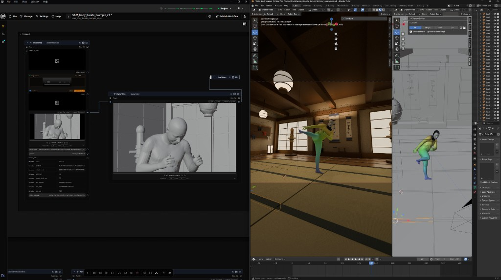

# Blender Bridge Library (GTN)



Move images and videos between Blender and Griptape Nodes (GTN), and let GTN
flows / agents drive the open Blender scene. Native Blender add-on — no
Docker, no scripts to re-run, no server inside Blender.

This library has two halves:

1. A **GTN library** (`blender_bridge_nodes/`) with a `Blender Bridge` node, a
   `Blender Scene Command` node, and an in-process local HTTP server that the
   Blender add-on talks to.
2. A **Blender add-on** (`blender_addon/griptape_bridge/`) that adds a
   **Griptape** tab to the 3D viewport sidebar (press `N`).

## How it works

```
Blender add-on  <--HTTP-->  Bridge server (inside GTN engine)  <--in-process-->  GTN nodes
 (pure client)                     127.0.0.1:7890
```

- **Blender -> GTN:** Type an optional prompt in the panel, then click
  `Send Viewport`, `Send Camera View`, `Send Image File...` or
  `Send Video File...`. The capture is POSTed to the bridge together with the
  prompt, camera transform/lens, and scene info. The `Blender Bridge` node
  outputs it as `image` / `video`, plus `prompt` and `camera_info`.
- **GTN -> Blender:** Feed a result into the node's `media_to_send` input and
  click `Send to Blender` (or just run the flow). With `Auto-Receive` on, the
  add-on places it in the scene using the selected mode: **Image Editor**,
  **Plane at Cursor**, **Camera Background**, **Sequencer Strip**, or
  **Save to Disk Only**. Files are saved to `//griptape_bridge/` next to your
  .blend (temp folder if unsaved).
- **Scene commands (agent control):** With `Listen for Commands` enabled, the
  add-on polls the bridge command queue and executes commands on Blender's
  main thread. Queue commands from a flow with the `Blender Scene Command`
  node — or from a Griptape agent / MCP tool hitting the HTTP endpoints
  directly.

The HTTP server starts automatically when the GTN engine loads the library.
It listens on `127.0.0.1:7890` by default.

## Configuration

| Setting | Default | How to change |
| --- | --- | --- |
| Port | `7890` | Set env var `GTN_BLENDER_BRIDGE_PORT` before starting the GTN engine, and set the matching port in Blender's add-on preferences. |
| Allow Python commands | off | Blender: Edit > Preferences > Add-ons > Griptape Bridge > `Allow Python Commands`. |

## Installing the GTN library

1. Register `blender_bridge_nodes/griptape_nodes_library.json` in GTN Settings
   > Libraries (as you do for the other libraries in this repo).
2. Restart / rescan libraries. You'll find **Blender Bridge** and
   **Blender Scene Command** under **Integrations**.

## Installing the Blender add-on

Requires **Blender 4.2 or newer**.

1. Zip the add-on folder (the zip must contain the `griptape_bridge` folder):

```powershell
Compress-Archive -Path "blender_addon\griptape_bridge" -DestinationPath "griptape_bridge.zip" -Force
```

2. In Blender: `Edit > Preferences > Add-ons > Install from Disk...` and pick
   the zip (dragging the zip onto the Blender window also works in 4.2+).
3. Enable **Griptape Bridge**. The panel appears in the 3D viewport sidebar
   (`N` key) under the **Griptape** tab.
4. Click the refresh icon to test the connection (GTN engine must be running
   with the library loaded).

## Scene commands

Sent via the `Blender Scene Command` node (`command` + `params_json`), or
`POST /commands` with `{"command": "...", "params": {...}}`.

| Command | Params | Result |
| --- | --- | --- |
| `scene_info` | - | Scene name, frame range, fps, resolution, object list, active camera. |
| `list_cameras` | - | Camera object names. |
| `get_camera` | `name?` | Transform + lens of the camera (active camera if omitted). |
| `set_camera` | `name?`, `location?`, `rotation_euler?`, `lens_mm?`, `keyframe?`, `frame?` | Updated camera payload. Vectors are `[x, y, z]` (rotation in radians). |
| `snapshot` | `camera?`, `width?`, `height?` | OpenGL render from the camera as `image_data_url` (the node exposes it on its `image` output). |
| `add_primitive` | `kind` (cube, sphere, plane, cylinder, cone, torus, empty, camera, light, sun, area_light), `name?`, `location?`, `rotation_euler?`, `scale?` | Created object name. |
| `move_object` | `name`, `location?`, `rotation_euler?`, `scale?` | Updated object payload. |
| `delete_object` | `name` | Deleted object name. |
| `import_latest_as_plane` | `location?` | Imports the last media GTN sent to Blender as a textured plane at the cursor. |
| `set_frame` | `frame` | New current frame. |
| `run_python` | `code` | Runs arbitrary Python (`bpy` available; set a `result` variable to return data). **Disabled unless enabled in add-on preferences.** |

Example `params_json` for `add_primitive`:

```json
{"kind": "cube", "name": "Blockout_01", "location": [0, 4, 1], "scale": [2, 2, 1]}
```

## Run Griptape Nodes from Blender (proxy nodes)

The **Run Griptape Node** section of the panel is a dynamic, schema-driven UI
for the whole GTN catalog:

1. Click refresh — the panel lists every node type registered in the engine
   (use the search field to filter).
2. Pick a node and click `Load Parameters` — the node's parameters are
   fetched from the engine and rendered as native Blender widgets (dropdowns
   for `Options` choices, sliders for numbers, checkboxes for bools).
3. Image/video input parameters render as a `use capture` toggle: on
   Generate, a fresh camera-view capture is sent to the bridge and wired into
   that parameter automatically.
4. `Generate` runs the node inside the GTN engine (in a hidden
   `blender_proxy_flow`); when it finishes, any image/video output is staged
   on the bridge and auto-placed in the scene using your Receive settings.

No per-node UI code and no hand-authored workflows required — the form is
generated from the node's own parameter definitions. Multi-node pipelines
are still best built as flows in the GTN editor; the proxy runner covers the
"one node = one preset" case (image gen, upscale, etc).

Proxy endpoints: `GET /proxy/nodes`, `GET /proxy/schema?library=..&node_type=..`,
`POST /proxy/run {library, node_type, params, attach_param}`,
`GET /proxy/jobs/<id>`.

## Endpoints (for reference / debugging / MCP tools)

| Method | Path | Purpose |
| --- | --- | --- |
| GET | `/health` | Liveness check. |
| POST | `/to_gtn` | Blender uploads media (raw bytes; headers `X-Filename`, `X-Kind`, `X-Meta` = base64 JSON). |
| GET | `/to_gtn/latest` | Metadata of the last Blender upload. |
| GET | `/to_gtn/latest/raw` | Raw bytes of the last Blender upload. |
| POST | `/to_blender` | GTN uploads result media (same headers). |
| GET | `/to_blender/latest` | Metadata of the last GTN result. |
| GET | `/to_blender/latest/raw` | Raw bytes of the last GTN result. |
| POST | `/commands` | Enqueue a scene command `{"command", "params"}` -> `{"id"}`. |
| GET | `/commands/next` | Blender polls: pops the oldest queued command. |
| POST | `/commands/result` | Blender posts `{"id", "ok", "result"}`. |
| GET | `/commands/<id>` | Command status + result. |

Any agent that can make HTTP calls (a Griptape agent tool, an MCP server, a
script) can drive the scene through `/commands`.

## Text -> 3D scene with MCP

`blender_bridge_mcp.py` is an MCP server that exposes the scene commands as
tools (`scene_info`, `add_primitive`, `set_camera`, `snapshot` — which
returns an image so the agent can *see* the scene — and `run_python` for
everything else). Point Claude Desktop or Cursor at it and ask for a scene.

1. GTN engine running with this library; Blender open with the add-on and
   **Listen for Commands** enabled (plus **Allow Python Commands** in the
   add-on preferences if you want `run_python`).
2. Add to your MCP client config (Cursor `~/.cursor/mcp.json` or Claude
   Desktop `claude_desktop_config.json`):

```json
{
  "mcpServers": {
    "blender": {
      "command": "uv",
      "args": ["run", "--with", "mcp<2", "python",
               "/path/to/griptape-nodes-library-blender-bridge/blender_bridge_mcp.py"]
    }
  }
}
```

3. Ask the agent: *"Build me a night rooftop blockout in Blender: ground
   plane, a few boxes as buildings, a camera at eye height with a 24mm lens,
   then show me a snapshot."* The agent chains the tools, checks its own work
   with `snapshot`, and iterates.

## Roadmap

- Phase 2: preset flows — a manifest that maps preset names to flows, listed
  in the Blender panel, triggered via `POST /run_flow`.
- Phase 3: shot packages (depth/normal passes, camera animation curves),
  camera path round-trip, mesh import.
